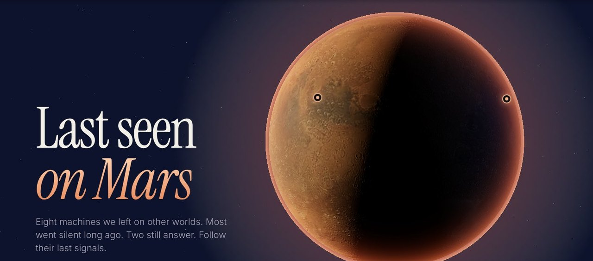
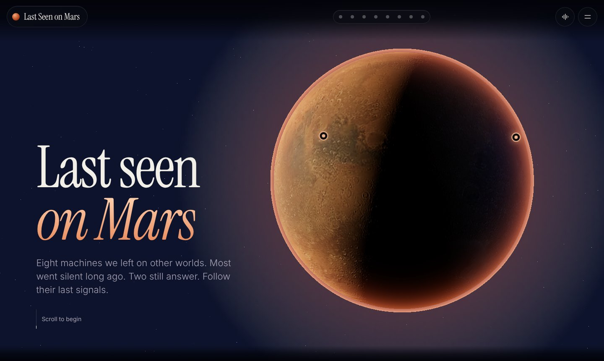
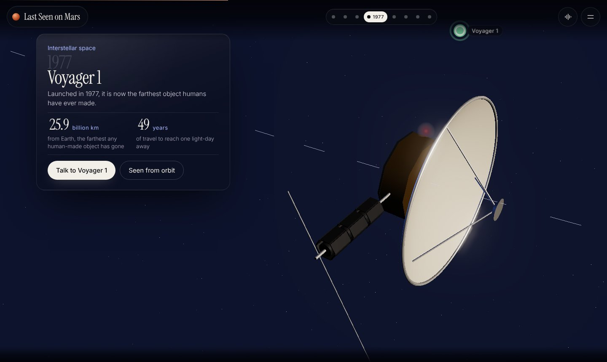
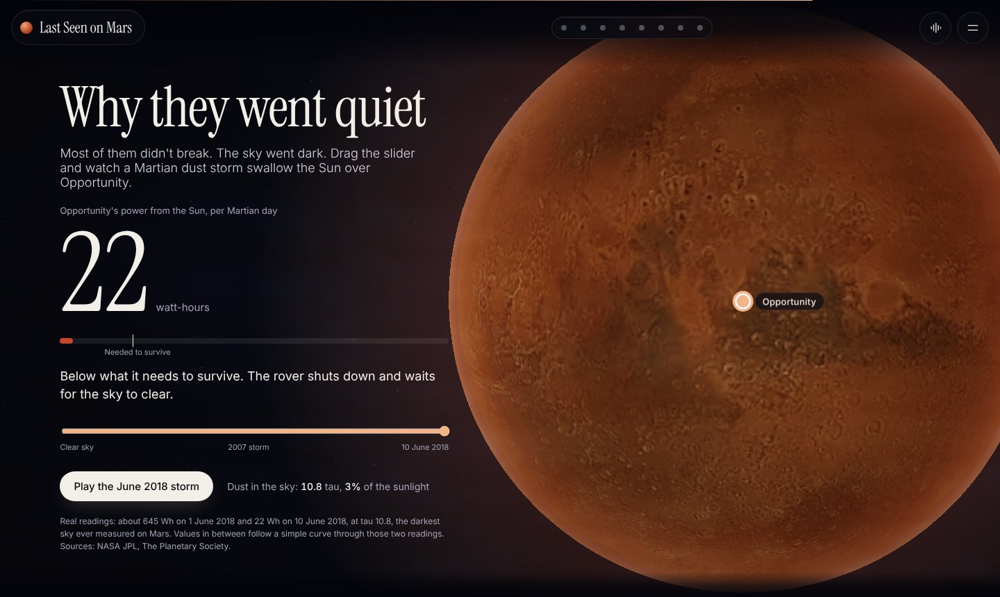
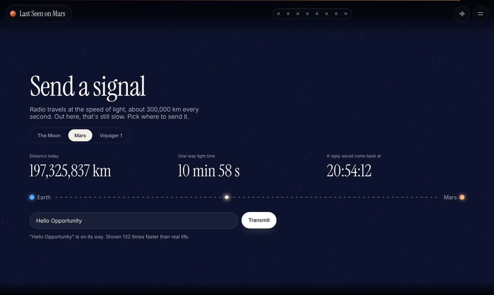
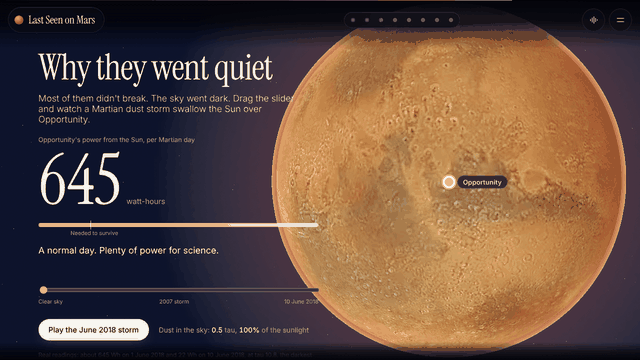

<div align="center">



# Last Seen on Mars

**Eight machines we left on other worlds. Most went silent long ago. Two still answer.**

An interactive 3D story about the hardware NASA left on the Moon, on Mars and in interstellar space,<br />and the science each machine made possible.

<br />

[](https://last-seen-on-mars.vercel.app)
[](https://www.spaceappschallenge.org)
[](https://threejs.org)
[](https://vite.dev)

**[Open the live site](https://last-seen-on-mars.vercel.app)** &nbsp;&nbsp;|&nbsp;&nbsp; **[Watch the demo](#)** &nbsp;&nbsp;|&nbsp;&nbsp; **[The challenge](#the-challenge)**

</div>

<br />

## The challenge

**NASA Space Apps Challenge 2026: *Abandoned but not Forgotten*.** Tell school-age kids the story of NASA's discarded equipment on the Moon and Mars, and the science it made possible.

Kids know "a rover went to Mars". Few know that Opportunity was built for **90 days** and drove for **almost 15 years**, that a mirror left by Apollo 11 is **still used by scientists today**, or that Voyager 1 is about to become the **first object ever to be a full light-day from Earth**. Those facts sit on NASA pages written for adults. This project turns them into one journey you scroll through, where every machine can talk back.

<br />

## A look inside

<table>
  <tr>
    <td width="50%"><br /><sub><b>The opening.</b> A 3D Mars lit from the side, with real NASA surface maps.</sub></td>
    <td width="50%"><br /><sub><b>Voyager 1.</b> A detailed 3D model with its dish pointed home, sending radio waves.</sub></td>
  </tr>
  <tr>
    <td width="50%"><br /><sub><b>Why they went quiet.</b> Opportunity's power at the peak of the June 2018 storm.</sub></td>
    <td width="50%"><br /><sub><b>Signal lab.</b> Today's real distance to Mars and how long a message takes.</sub></td>
  </tr>
</table>

<br />

## Features

| | |
|---|---|
| **3D journey through space** | Scroll and the camera travels Mars → Moon → Voyager 1, one chapter per machine, in the order they arrived (1967 to 2021). |
| **Real landing sites** | Every machine is pinned at its true latitude and longitude. Each planet turns so the site rotates into daylight. |
| **Talk to the machines** | Ask anything. Each machine answers in the first person using only its NASA fact sheet, and admits when it doesn't know. |
| **Real NASA recordings** | InSight's Martian wind and a marsquake, Ingenuity's rotors heard by Perseverance, "The Eagle has landed", and the sound of interstellar space from Voyager 1. |
| **Seen from orbit** | The real HiRISE and LROC orbital photo of each landing site. |
| **Dust storm simulator** | Darken the Martian sky on the real 3D planet and watch Opportunity's power fall from 645 to 22 watt-hours. |
| **Planned vs. actually lived** | How long each mission was planned for, against how long it really lasted. |
| **Live Mars clocks** | The local solar time right now at every Mars landing site. |
| **Live Voyager distance** | Voyager 1's distance from Earth, ticking up in real time. |
| **Signal lab** | Send a message to the Moon, Mars or Voyager 1 with real light-travel time, using today's Earth–Mars distance from JPL orbital elements. |
| **Mission log** | Reach all eight machines to unlock a certificate with your name. |

<br />

<div align="center">
  
  <br />
  <sub>The June 2018 dust storm, replayed on the real 3D Mars.</sub>
</div>

<br />

## They lasted longer than anyone planned

| Machine | Planned | Actually lived |
|---|---|---|
| **Opportunity** | 90 Martian days | ~14 years · **57×** |
| **Spirit** | 90 Martian days | ~6 years · **25×** |
| **Ingenuity** | 30 Martian days, 5 flights | ~2.7 years, **72 flights** |
| **InSight** | 1 Mars year | ~4 years · **2×** |
| **Voyager 1** | 5 years | **49 years and counting** |
| **Apollo 11 laser mirror** | no end date | **still in use** |

<br />

## The eight machines

| Year | Machine | Where | Status |
|:---:|---|---|---|
| 1967 | Surveyor 3 | Ocean of Storms, Moon | Silent since May 1967 |
| 1969 | Apollo 11 laser mirror | Sea of Tranquility, Moon | 🟢 Still in use |
| 1972 | Apollo 17 lunar rover | Taurus-Littrow, Moon | Parked since Dec 1972 |
| 1977 | Voyager 1 | Interstellar space | 🟢 Still sending data |
| 2004 | Spirit | Gusev Crater, Mars | Silent since Mar 2010 |
| 2004 | Opportunity | Meridiani Planum, Mars | Silent since Jun 2018 |
| 2018 | InSight | Elysium Planitia, Mars | Silent since Dec 2022 |
| 2021 | Ingenuity | Jezero Crater, Mars | Grounded since Jan 2024 |

<br />

### Hear real NASA recordings
- Martian wind and a magnitude 3.7 marsquake, recorded by **InSight**
- **Ingenuity**'s rotors, heard by Perseverance's microphone
- "The Eagle has landed", Apollo 11, July 1969
- The plasma "sound" of interstellar space, recorded by **Voyager 1**

<details open>
<summary><b>Photos, sounds, maps and facts</b></summary>
<br />

- **NASA Image and Video Library** and **NASA/JPL Photojournal**: photos of each machine
- **HiRISE, Mars Reconnaissance Orbiter**: orbital photos of the Opportunity (PIA22549), Spirit (PIA12205), Ingenuity (PIA25174) and InSight (PIA26515) sites
- **LROC, Lunar Reconnaissance Orbiter Camera**: orbital photos of the Apollo 11 (PIA12925), Apollo 17 (PIA12920) and Surveyor 3 / Apollo 12 (PIA12903) sites
- **NASA Sounds from Beyond** and **NASA Historical Sounds**: InSight, Ingenuity and Apollo 11 recordings; Voyager 1 plasma sounds (PIA17045)
- **Planet maps**: NASA/JPL/USGS Viking MDIM 2.1 colour mosaic (Mars), NASA Blue Marble (Earth), lunar surface maps
- **JPL Keplerian Elements for Approximate Positions of the Major Planets**: live Earth–Mars distance
- **NASA mission pages** for all eight machines: every fact the machines say
- **Dust storm readings**: NASA JPL mission status reports and The Planetary Society

Every image and sound is credited in the app and links to its NASA source.
</details>

<br />

## Keeping it true

> The machines' feelings are imagined. Every fact is real.

1. A machine only says what is in its fact sheet in [`src/machines.js`](src/machines.js), and each fact sheet links to its NASA source.
2. Personality is allowed. Facts are never changed.
3. Where a value is modelled rather than measured (the dust simulator between its two real readings), the page says so.

<br />

## How it's built

Plain HTML, CSS and JavaScript with Vite. No framework, no backend: everything runs in the browser.

| File | What it does |
|---|---|
| [`src/scene.js`](src/scene.js) | 3D scene in Three.js: planets, landing-site coordinates, Voyager 1 model, camera flights, storm lighting |
| [`src/main.js`](src/main.js) | Chapters, chat, recordings, Mars clocks, Signal lab, dust simulator, lifespan list, certificate |
| [`src/machines.js`](src/machines.js) | The eight fact sheets with sources and credits |
| [`src/sound.js`](src/sound.js) | Ambient soundscape and radio effects (Web Audio API) |
| [`src/style.css`](src/style.css) | The design |

**Libraries:** Three.js · Lenis (smooth scrolling) · Instrument Serif and Inter (Fontsource)

<br />

## Run it locally

```bash
git clone https://github.com/sharanyashetty013-droid/last-seen-on-mars.git
cd last-seen-on-mars
npm install
npm run dev
```

The NASA photos and sounds are included. `bash get-nasa-photos.sh` re-downloads them from NASA if needed.

<br />

## AI tools used

Claude (Anthropic) was used as a coding and design assistant. All facts were checked against the NASA sources above.

<br />

<div align="center">

**Team Git dwellers**<br />
Sharanya L Shetty · NMAMIT, Karkala, India

<sub>NASA does not endorse this project. NASA photos, sounds and data are public domain; credits appear in the app.</sub>

</div>
